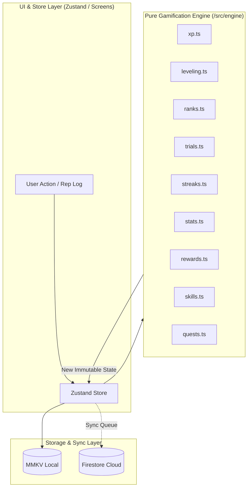

# RepRift — Gamification Engine Implementation Plan

> **Target Directory:** `reprift/src/engine`  
> **Test Suite:** `reprift/tests/engine`  
> **Core Mandate:** Pure functions only, zero side effects, 100% test coverage before UI wiring.

---

## 1. Architectural Principles

All gamification logic in RepRift is strictly decoupled from UI, device APIs, and persistence mechanisms.



### Non-Negotiable Rules
1. **Purity & Immutability:** Every function in `/src/engine` accepts inputs and returns new objects. No mutating arguments, no reliance on global state, and no `Date.now()` calls inside functions (timestamps are passed in as arguments).
2. **Deterministic & Testable:** Any calculation given the same input will always return the exact same output.
3. **Additive Reps:** Repetitions and workouts are additive across devices. Engine logic sums logged values rather than overwriting.
4. **Resilience & Bounds:** Clamped penalties (never demote level, never reduce XP below 0), multi-level jump loop resolution, and soft-capped log bounds.

---

## 2. Module Breakdown & File Structure

```
reprift/
├── src/
│   ├── types/
│   │   └── engine.ts               # Core data structures and interfaces
│   └── engine/
│       ├── xp.ts                   # Base XP values, formulas, exercise multipliers
│       ├── leveling.ts             # awardXP, multi-level checks, SP awards, auto-stat ticks
│       ├── ranks.ts                # Rank definitions (E -> SSS), thresholds, unlocks
│       ├── trials.ts               # Gate validation, objective checks, 24h cooldown
│       ├── streaks.ts              # Daily streaks, shield auto-consume, recovery protocol
│       ├── penalties.ts            # Missed daily quest penalty calculation
│       ├── stats.ts                # Manual SP allocation validation
│       ├── rewards.ts              # Milestone armor unlock evaluation
│       ├── skills.ts               # Skill tree prerequisites, unlock & verification rules
│       ├── quests.ts               # Daily quest progress calculation, additive rep sums
│       └── index.ts                # Barrel export
└── tests/
    └── engine/
        ├── xp.test.ts
        ├── leveling.test.ts
        ├── ranks.test.ts
        ├── trials.test.ts
        ├── streaks.test.ts
        ├── penalties.test.ts
        ├── stats.test.ts
        ├── rewards.test.ts
        ├── skills.test.ts
        └── quests.test.ts
```

---

## 3. Detailed Specifications per Module

### 3.1 `types/engine.ts`
- **`RankTier`**: `'E' | 'D' | 'C' | 'B' | 'A' | 'S' | 'SS' | 'SSS'`
- **`StatFocus`**: `'str' | 'vit' | 'agi'`
- **`UserStats`**: `{ str: number, vit: number, agi: number }`
- **`HunterProfile`**:
  ```typescript
  export interface HunterProfile {
    uid: string;
    displayName: string;
    avatarId: string;
    timezone: string;
    level: number;
    xp: number; // XP within current level
    rank: RankTier;
    statPoints: number; // Unspent SP
    stats: UserStats;
    currentStreak: number;
    longestStreak: number;
    streakShields: number;
    lastShieldUsedDate: string | null;
    equippedTitle: string | null;
    pendingTrialUnlocked: boolean;
    createdAt: number;
    lastActiveAt: number;
  }
  ```
- **`TrialObjective`**, **`TrialDefinition`**, **`TrialAttempt`**
- **`DailyQuest`**, **`QuestExerciseSlot`**, **`WorkoutLog`**
- **`SkillNode`**, **`SkillProgress`**
- **`MilestoneArmor`**

---

### 3.2 `engine/xp.ts`
- **Formula:**
  $$\text{xpRequired}(\text{level}) = \lfloor 100 \times \text{level}^{1.5} \rfloor$$
- **Base XP per exercise action:**
  - Push-ups: 1 XP / rep (`str`)
  - Pull-ups: 3 XP / rep (`str`)
  - Sit-ups / Core: 1 XP / rep (`vit`)
  - Squats: 1 XP / rep (`str`)
  - Run: 1 XP / 10 meters (`agi`)
  - Plank / Holds: 1 XP / 5 seconds (`vit`)
- **Multipliers:**
  - Beginner: $1.0\times$
  - Intermediate: $1.5\times$
  - Advanced: $2.0\times$
  - Elite: $3.0\times$
  - HealthKit/Health Connect Verified Run: $+10\%$ bonus ($1.1\times$)
- **Completion Bonuses:**
  - Daily Quest complete bonus: $+50\text{ XP}$ (`vit`)
  - Perfect week bonus: $+200\text{ XP}$ (`vit`)
- **Key Functions:**
  - `xpRequired(level: number): number`
  - `calculateExerciseXP(exerciseId: string, countOrDuration: number, difficulty: ExerciseDifficulty, isVerified?: boolean): { xp: number; statFocus: StatFocus }`

---

### 3.3 `engine/leveling.ts`
- **Core Loop:**
  ```mermaid
  flowchart TD
      Start([awardXP]) --> Calc[currentXP + xpToAdd]
      Calc --> Check{currentXP >= xpRequired?}
      Check -- Yes --> Inc[level++<br/>statPoints += 3<br/>stats[statFocus] += 1<br/>currentXP -= required]
      Inc --> MultiCheck{currentXP >= xpRequired?}
      MultiCheck -- Yes --> Inc
      MultiCheck -- No --> RankCheck{Eligible for Next Rank?}
      Check -- No --> Ret[Return New HunterProfile]
      RankCheck --> Flag[Set pendingTrialUnlocked = true if trial required<br/>or auto-promote if no trial]
      Flag --> Ret
  ```
- **Key Functions:**
  - `awardXP(user: HunterProfile, xpToAdd: number, statFocus: StatFocus): AwardXPResult`
  - Output interface:
    ```typescript
    export interface AwardXPResult {
      user: HunterProfile;
      levelsGained: number;
      newRankReady: boolean;
      unlockedTrialRank: RankTier | null;
    }
    ```

---

### 3.4 `engine/ranks.ts`
- **Rank Tiers & Thresholds:**
  | Rank | Name | Min Level | Trial Required? | Unlock / Ability |
  |---|---|---|---|---|
  | **E** | Unawakened | 1 | No | Base UI (Cyan Aura) |
  | **D** | Awakened | 10 | Yes | Aura color + 1 ability slot |
  | **C** | Raider | 20 | Yes | Side-quest slot +2, shield cap 3 |
  | **B** | Elite | 35 | Yes | Custom titles, shadow unlock, shield cap 5 |
  | **A** | Monarch Candidate | 50 | Yes | Leaderboard flair, guild raid start |
  | **S** | Monarch | 75 | Yes | Custom UI theme, guild XP buff |
  | **SS** | Sovereign | 100 | Yes | Exclusive aura, prestige teaser |
  | **SSS** | Absolute | 150 | Yes | Prestige / "New Game+" |
- **Key Functions:**
  - `getRankDefinition(rank: RankTier): RankDefinition`
  - `getNextRank(rank: RankTier): RankTier | null`
  - `isTrialEligible(user: HunterProfile): boolean`
  - `promoteRank(user: HunterProfile, toRank: RankTier): HunterProfile`

---

### 3.5 `engine/trials.ts`
- **Rules:**
  1. Objectives are evaluated in a single session within `timeLimitSec`.
  2. All objectives are AND-ed: every single target must be satisfied or exceeded.
  3. Cooldown check: $24\text{ hours}$ (86,400,000 ms) minimum between failed attempts.
  4. Failure never deducts XP, levels, or stat points.
- **Key Functions:**
  - `canAttemptTrial(lastAttemptAt: number | null, now: number): { allowed: boolean; remainingCooldownMs: number }`
  - `validateTrialAttempt(trialDef: TrialDefinition, attempt: TrialSessionData, now: number): TrialValidationResult`

---

### 3.6 `engine/streaks.ts`
- **Rules:**
  1. **Success:** Daily quest completed $\to$ `currentStreak + 1`, update `longestStreak`.
  2. **Shield Protection:** Missed day $\to$ if `streakShields > 0` AND not shielded on the immediate previous day $\to$ consume 1 shield, preserve streak, record `lastShieldUsedDate`.
  3. **Break:** Missed day without available shield (or consecutive missed day) $\to$ `currentStreak = 0`.
  4. **Recovery Protocol (Rest Day):** 1 per rolling 7 days. Preserves streak without consuming a shield.
  5. **Milestone Shield Grants:**
     - 7-day streak $\to$ +1 shield
     - 30-day streak $\to$ +2 shields
     - 100-day streak $\to$ +3 shields
     - Cap: 3 shields (5 for B-Rank and above).
- **Key Functions:**
  - `evaluateDailyStreak(user: HunterProfile, input: StreakEvaluationInput): StreakEvaluationResult`

---

### 3.7 `engine/penalties.ts`
- **Rules:**
  - Applied when a daily quest is missed and unshielded.
  - Deducts $10\%$ of current-level XP: $\lfloor 0.10 \times \text{xpRequired}(\text{user.level}) \rfloor$.
  - **Hard Bounds:**
    - XP never drops below $0$.
    - Level is **never** demoted.
- **Key Functions:**
  - `calculateMissedQuestPenalty(user: HunterProfile): { penaltyXP: number; updatedUser: HunterProfile }`

---

### 3.8 `engine/stats.ts`
- **Rules:**
  - Players allocate earned `statPoints` to `str`, `vit`, or `agi`.
  - $\Delta\text{str} + \Delta\text{vit} + \Delta\text{agi} \le \text{user.statPoints}$.
  - Points cannot be negative.
- **Key Functions:**
  - `allocateStatPoints(user: HunterProfile, allocation: { str?: number; vit?: number; agi?: number }): HunterProfile`

---

### 3.9 `engine/rewards.ts`
- **Milestone Catalog:**
  - 100 lifetime pull-ups $\to$ E-Rank Gauntlets (Hands)
  - 60s plank hold $\to$ E-Rank Chestplate (Chest)
  - 50 km lifetime run $\to$ E-Rank Boots (Feet)
  - Pass D trial $\to$ D-Rank Helm (Head)
  - 30-day streak $\to$ D-Rank Pauldrons (Shoulders)
  - 10 clean muscle-ups $\to$ C-Rank Gauntlets (Hands)
  - 500 lifetime pull-ups $\to$ C-Rank Cloak (Back)
  - 100-day streak $\to$ B-Rank Set (Full)
  - 1000 lifetime pull-ups + 30s L-sit $\to$ A-Rank Set (Full)
  - 1-year active + level 75 $\to$ S-Rank Aura (Aura)
  - Level 150 + all trials passed $\to$ SSS Monarch Skin (Full)
- **Key Functions:**
  - `evaluateMilestones(metrics: UserMilestoneMetrics, currentInventory: string[]): string[]`

---

### 3.10 `engine/skills.ts`
- **Rules:**
  - 4 trees: Push, Pull, Core, Legs.
  - **Unlock requirement:** Prerequisite node must be both unlocked AND verified, and user must have $\ge \text{spCost}$ available SP.
  - **Verification requirement:** Proof logged on a calendar day **strictly after** the unlock date.
- **Key Functions:**
  - `canUnlockNode(node: SkillNode, progress: Record<string, SkillProgress>, availableSP: number): boolean`
  - `unlockNode(node: SkillNode, progress: Record<string, SkillProgress>, availableSP: number, now: number): { progress: Record<string, SkillProgress>; remainingSP: number }`
  - `canVerifyNode(node: SkillNode, nodeProgress: SkillProgress, repsLogged: number, logTimestamp: number): boolean`

---

### 3.11 `engine/quests.ts`
- **Additive Logging Rule:**
  - Device logs are summed rather than replaced.
  - Soft-cap individual log entry at 500 reps (flag for review if exceeded).
- **Key Functions:**
  - `applyWorkoutLogToQuest(quest: DailyQuest, log: WorkoutLog): DailyQuest`
  - `isDailyQuestComplete(quest: DailyQuest): boolean`
  - `mergeWorkoutLogs(existingLogs: WorkoutLog[], incomingLogs: WorkoutLog[]): WorkoutLog[]`

---

## 4. Test Strategy & Table-Driven Coverage Matrix

| Test Suite | Key Scenarios Covered | Target Assertions |
|---|---|---|
| `xp.test.ts` | Levels 1–200 curves, exercise XP rates, difficulty multipliers, HealthKit 10% bonus, negative/zero inputs | 25+ |
| `leveling.test.ts` | Single level-up, multi-level leaps (e.g. +3 levels from 10km run), exact threshold boundaries, auto-stat incrementation, trial unlock triggers | 30+ |
| `ranks.test.ts` | All 8 tiers (E to SSS), min level validation, next rank lookup, trial necessity | 20+ |
| `trials.test.ts` | All objectives passed within time limit, 1 objective failed, session time expired, 24h retry lockout, retry allowed after 24h+1s | 25+ |
| `streaks.test.ts` | Standard streak increment, shield consumption on missed day, consecutive missed day lock (no double shield), 1 free recovery day / week, shield awards at 7/30/100, shield caps (3 for E-C, 5 for B+) | 35+ |
| `penalties.test.ts` | 10% penalty calculation, clamping at 0 XP, verification that level never decreases | 15+ |
| `stats.test.ts` | Exact SP spend, partial SP spend, over-spend rejection, negative allocation rejection | 15+ |
| `rewards.test.ts` | Individual milestone triggers, compound triggers, idempotency (no duplicate unlocks) | 20+ |
| `skills.test.ts` | Tree progression, prerequisite unverified check, same-day verification rejection, cross-day verification approval | 25+ |
| `quests.test.ts` | Additive rep sum across devices, soft-cap warning threshold, 4/4 exercise completion state | 20+ |

---

## 5. Execution Steps Upon Approval

1. **Step 1 — Types:** Create `src/types/engine.ts` with all shared interfaces.
2. **Step 2 — Pure Engine Implementation:** Write `xp.ts`, `leveling.ts`, `ranks.ts`, `trials.ts`, `streaks.ts`, `penalties.ts`, `stats.ts`, `rewards.ts`, `skills.ts`, `quests.ts`, and `index.ts`.
3. **Step 3 — Jest Setup & Configuration:** Configure `jest.config.js` with TypeScript/ts-jest support.
4. **Step 4 — Unit Test Suite:** Implement test files in `tests/engine/` matching the test matrix.
5. **Step 5 — Verification:** Run all Jest tests, verify 100% pass rate, and type-check with `npx tsc --noEmit`.
